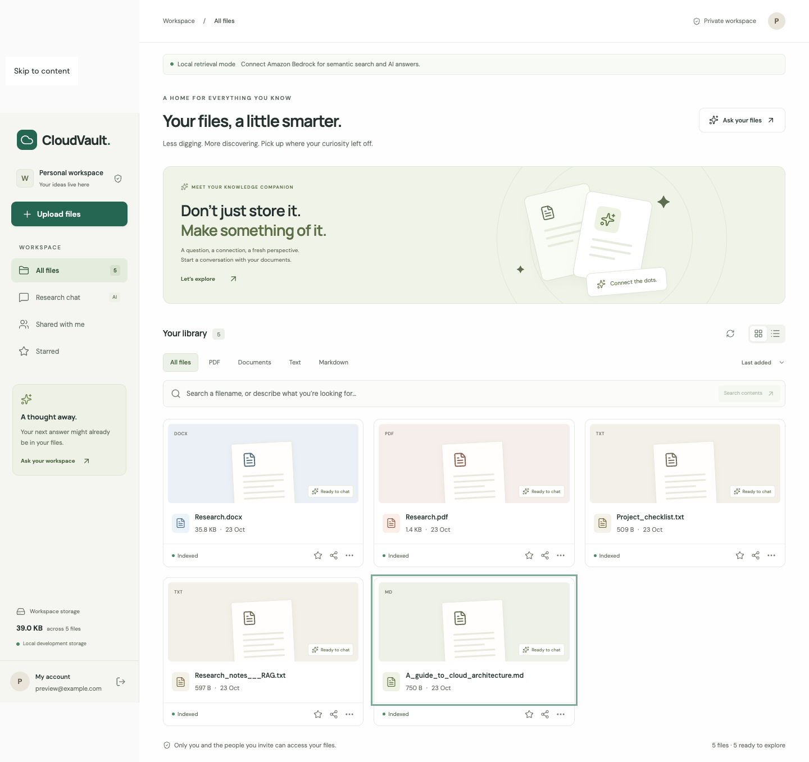
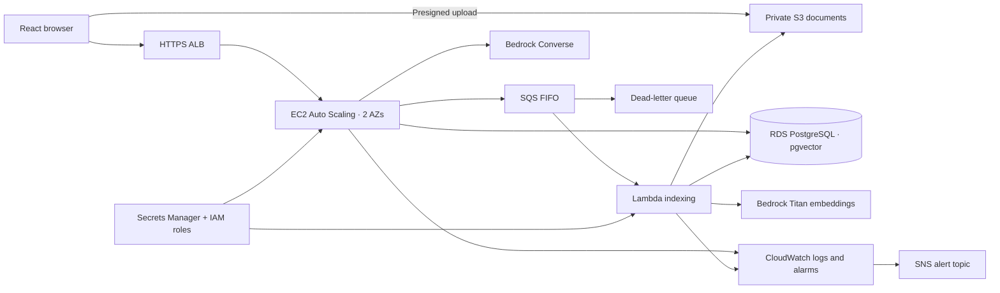

# CloudVault

A document workspace with natural-language file discovery, permission-aware retrieval, and source-grounded chat. Built for a cloud architecture class with React, Tailwind CSS, Express, and an AWS deployment stack.



## What works

- Email/password registration and sign-in; bcrypt password hashes and expiring JWT sessions.
- Upload PDF, DOCX, TXT, and Markdown files (25 MB maximum).
- File library with grid/list layouts, filename filtering, content search, type filters, sorting, and personal stars.
- PDF viewing and extracted-text viewing for other supported documents; authenticated downloads.
- Dedicated research chat across accessible documents, plus document-scoped chat beside the viewer.
- Source cards that open the original document; previous user questions provide follow-up context.
- Share with another registered account and revoke access. The same permissions gate file viewing, downloading, search, and RAG.
- Asynchronous indexing with processing/error states and retries.

There are no bundled users, passwords, private keys, personal documents, or deployment credentials. The optional sample files are generic educational text and are uploaded into the signed-in user's account through the real upload pipeline.

## Run locally

Use Node.js 22.12+ or a current Node.js LTS.

```bash
npm ci --prefix backend
npm ci --prefix frontend
cp backend/.env.example backend/.env
npm start --prefix backend
```

In another terminal:

```bash
npm run dev --prefix frontend
```

Open [localhost:5173](http://localhost:5173), create your own account, and upload a document or select **Try sample files**. Vite proxies `/api` to port 3000. Set `JWT_SECRET` in `backend/.env` if you want sessions to survive local restarts; without it, development uses a fresh random signing key at each start.

Local development needs no cloud credentials. It uses a local JSON database, local files, and deterministic **lexical** vectors. Local chat returns excerpts and explicitly labels its limitations. It is not a semantic embedding model or a local LLM.

For actual semantic search and generated RAG answers, set `AI_ENGINE=bedrock`, choose a supported `BEDROCK_CHAT_MODEL`, and authenticate the AWS SDK through an IAM role or your local AWS profile. Use the same embedding engine for ingestion and queries; reindex every document after changing engines or models. The cloud stack sets Bedrock, S3, RDS, and SQS automatically.

## AWS architecture



The upload-completion API publishes the indexing event after the browser finishes its S3 PUT. Lambda extracts text, creates overlapping chunks, embeds them into 1024-dimensional vectors, and writes them to pgvector. Retrieval filters document access in the database before returning source passages to the model.

The infrastructure provisions **55 resources** covering VPC networking, private compute, EC2, ALB, Auto Scaling, encrypted RDS, private S3, SQS and its DLQ, Lambda, IAM, Secrets Manager, CloudWatch, SNS, and an optional Route 53 record. It uses an existing ACM certificate, SSM's public AMI parameter, and an existing artifact bucket. See [the deployment guide](infra/AWS_SETUP_GUIDE.md) and [the class architecture report](CloudVault_System_Architecture.md).

## Docker

The Docker image builds the web client and serves it with Express. The Compose setup uses real PostgreSQL with pgvector; it runs a **single application replica** with local file storage and local excerpt retrieval.

```bash
export JWT_SECRET="$(openssl rand -hex 32)"
export DB_PASSWORD="$(openssl rand -hex 24)"
docker compose up --build
```

Open [localhost:3000](http://localhost:3000). Docker must be running. For multiple app replicas use S3 and SQS; local uploads are not shared between hosts.

## Verification

```bash
npm test --prefix backend
npm run lint --prefix frontend
npm run build --prefix frontend
npm audit --prefix backend
npm audit --prefix frontend
python3 scripts/check-secrets.py
python3 infra/stack.py
cfn-lint infra/cloudformation.json
```

The API integration test uses temporary storage and verifies registration, invalid authentication, upload authorization, indexing, document-scoped retrieval, content search, downloads, sharing, revoked access, deletion, and cross-user isolation. GitHub Actions runs these checks on pushes and pull requests. Browser flows were checked on desktop and at 375px width. Automated axe checks found no WCAG 2 A/AA or 2.1 AA violations in the tested sign-in, library, and research-chat states; live AWS, Bedrock, and RDS failover need validation after deployment.

## Practical boundaries

Scanned/image-only PDFs require OCR before upload. DOCX previews show extracted text; Markdown is rendered safely. Original page layout is preserved only for PDFs. Chat is session-local and currently keeps previous **user questions**, not a full persisted conversation history. Sharing is read-only and requires an existing account. Stars are stored in the browser per account.

The local JSON database is for one development process. Cloud deployments require PostgreSQL. Long-lived AWS access keys are not needed: the SDK uses its default credential chain. Generated artifacts, environment files, upload contents, and local database records are ignored by Git. If old credentials were ever used or distributed, revoke them at their providers; deleting a copy cannot revoke a credential.
